# v0.12.4 Art Detail Pass — Master Item Redesign Checklist

Owner feedback: items currently read as flat, smooth single-colour boxes. This release is a **full item-by-item redesign** at **2x pixel density**, lit from top-left with a consistent dark outline (`#2a1d2e`), giving every piece authentic texture, defining silhouette features, and material realism.

---

## Category Research & Pixel-Art Techniques

### PLANTS
- Clustered foliage volumes: group leaves into organic cloud/pillow clumps rather than single geometric blocks.
- 4-5 color ramp: deep shadow (#163e1c), mid-dark (#226c30), base green (#369c4a), bright highlight (#6de478), dew accent (#b2ffb8).
- Top-left illumination: highlights on top-left crests, deep undercuts and crevice shadows underneath clumps.
- Irregular silhouette with organic leaf jaggies and stray leaf tips spilling beyond the rim.
- Petal clusters for flowering plants (hydrangeas, marigolds, blossoms) using delicate 2x dot clusters.

### FITNESS
- Accurate structural silhouettes: 2:1 angled tubular frames, cylindrical flywheel with metallic sheen bands.
- Mechanical articulation: pedal cranks with pedals, saddle on seatpost, contoured aerodynamic handlebars, digital console display with screen glow.
- Rowing machine long extruded rail with contoured sliding seat, front flywheel housing, chain handle, footplates with heel cups and straps.
- Heavy steel equipment with laser-cut peg holes (squat rack), knurled barbell with cast-iron weight plates.
- Locker door vertical seams with ventilation louvers and chrome latch hasps; water cooler with inverted blue bottle, bubble highlight and dual spigots.

### ENTERTAINMENT
- Arcade & tech glow: glowing CRT screens with scanlines/matrix graphics, backlit marquee titles, multi-colored buttons.
- Reflective metallic finishes: chrome trim, gold accents, polished piano lacquer with top lid prop stick, brass telescope tubes.
- Running belt texture with guide lines and console dashboard on treadmills.
- Textured playing surfaces: baize felt with corner pocket castings and ball cluster on pool tables.

### SEATING
- Fabric upholstery: seam piping along perimeter, button tufting with cross-crease shading, seat cushion compression folds.
- Wood craft: slatted bench seats with visible gaps, plank seams, end-grain cut highlights, cast-iron scrolled legs and bolt heads.
- Multi-material contrast: polished metal studs, turned wooden legs with brass toe caps, soft fabric pillows.

### TABLES
- Wood grain & planking: linear grain streaks along table length, plank seams with bevel highlights, end-grain edges.
- Marble tops: ivory/carrara marble with subtle mineral veining and polished brass rims.
- Architectural joinery: panelled front aprons, turned pedestal legs, mortise-and-tenon details.

### LIGHTING
- Luminous volume: glowing glass bodies with floating wax blobs, filaments, or internal crystal prisms.
- Specularity: sharp 1-2px white highlight streaks along cylindrical glass curves and polished chrome/brass caps.
- Warm ambient drop shadow / radial floor glow.

### RUGS
- Woven fiber texture: fine alternating weave flecks at 2x density, fringed yarn tassels at short ends.
- Multi-band borders: contrasting outer framing lines with subtle shadow drop onto floor tiles.

### DECOR
- Micro-detail at 2x: individual book spines with varying heights, colors, and gold title foil bands on bookshelves.
- Classical architectural mouldings: fluted pillar shafts, stepped plinths, carved cornice headers.
- Translucent materials: water refraction, glass display cases with specular diagonal sheen lines.

### KITCHEN_FOOD
- Commercial stainless steel: horizontal brush lines, bright specular edge highlights, cool slate undertones.
- Gastronomy micro-props: pans, burners with red control dials, espresso groupheads with portafilters, steam wands.
- Wooden street carts with fabric noren curtains and steaming pots.

### OUTDOOR_POOL
- Fluid water textures: caustics, subtle ripple highlights, deep gradient transition.
- Flagstone / slate coping with mortar lines and rounded bevelled edges.
- Marine hardware: polished 316 stainless ladders, anti-wave lane rope discs, textured starting block platforms.

### BEDS
- Soft fabric draping: duvets with natural folds, plump pillows with center dimples, vertical headboard stitch channels.

---

## Master Checklist (91 Catalogue Items)

| # | Item ID | Category | Item Name | 3–5 Defining Features | Status | Before | After |
|---|---|---|---|---|---|---|---|
| 1 | `stool` | seating | Pixel Stool | 4 turned timber legs with foot stretchers; Polished brass toe caps on legs; Nailhead brass trim ring around seat base; Tufted leather cushion with center button indent | Completed | 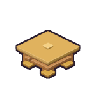 |  |
| 2 | `sofa` | seating | Cosy Sofa | Plush three-cushion seat with welted piping seams; Button-tufted backrest with diagonal crease shading; Curved padded roll arms; Turned wooden bun feet with floor shadow | Completed | 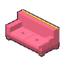 | 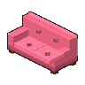 |
| 3 | `rooftop_sofa` | seating | Rooftop Sofa | Low-profile modern teak outdoor frame with plank slats; Weatherproof teal seat and back cushions with piping; Matching bolster accent pillows; Recessed plinth base | Completed | 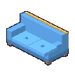 | 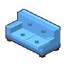 |
| 4 | `lamp` | lighting | Lava Lamp | Tiered brushed chrome pedestal base with cooling ribs; Clear glass chamber with glowing thermal liquid; Rising floating wax blobs with internal temperature highlights; Chrome conical cap and finial | Completed |  |  |
| 5 | `plant` | plants | Potted Fern | Flared terracotta pot with raised rim band; Rich dark potting soil with depth; Arching multi-tiered fern fronds with organic silhouettes in 4 greens; Blossom accent with petal details | Completed |  |  |
| 6 | `rug` | rugs | Starburst Rug | Woven woolen pile with starburst geometric medallion; Contrasting concentric inner and outer border bands; Twisted yarn fringe tassels along short ends; Fine woven thread texture at 2x density | Completed | 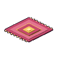 | 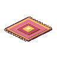 |
| 7 | `neon_sign` | lighting | Neon "HOTEL" Sign | Hand-bent glowing neon glass tubing spelling HOTEL; Wall mounting standoffs and dark transformer box; Intense neon core with diffuse outer color bloom; Drop glow casting colored light on wall | Completed |  |  |
| 8 | `jukebox` | entertainment | Pixel Jukebox | Iconic retro arched wooden cabinet with bubble tubes and chrome trim; Luminous rainbow neon lighting framing the perimeter; Glowing curved selection glass displaying title strips and record carousel mechanism; Chrome speaker grille bars with illuminated acoustic cloth | Completed | 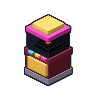 |  |
| 9 | `armchair` | seating | Plush Armchair | Winged club armchair silhouette with rounded piped armrests; Tufted backrest with deep button accents; Plump removable seat cushion with natural fabric sag; Tapered hardwood legs | Completed | 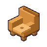 | 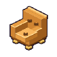 |
| 10 | `deckchair` | seating | Striped Deckchair | Folding beechwood scissor frame with brass pivot rivets; Striped durable canvas sling seat with natural body sag; Multi-slot adjustment notches on rear frame; Fabric fringe hem | Completed |  |  |
| 11 | `reception_desk` | tables | Reception Desk | Curved architectural front with vertical timber slats; Polished slab counter with overhang; Recessed receptionist desk with desktop monitor and service bell; Base toe-kick with concealed LED runner | Completed | 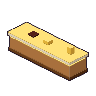 | 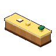 |
| 12 | `bookshelf` | decor | Tall Bookshelf | Full-height solid mahogany cabinet with plinth base and top cornice; Upright side gable panels and three recessed sturdy shelves; At least 15 individual books with varying heights, spine colors, and gold title foil bands; Book end bookends holding leaning volumes | Completed |  |  |
| 13 | `bar_counter` | kitchen_food | Rooftop Bar | Solid dark mahogany bar counter with curved bullnose drink rail; Raised wood-panelled front with fluted pilasters; Polished brass foot rail with floor mounting brackets; Stainless steel back-bar work deck with bottle tiers | Completed | 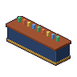 | 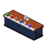 |
| 14 | `string_lights` | lighting | String Light Post | Wrought iron lantern post with decorative scroll bracket; Catenary swag cable with vintage Edison bulbs; Glowing spiral filaments visible through clear glass; Warm ambient halo around each bulb | Completed |  |  |
| 15 | `aquarium` | decor | Luminous Reef Tank | Opti-white clear glass tank with top water meniscus; Lively underwater reef scape with purple/orange corals and live rock; Rising aerator bubble stream and swimming tropical clownfish; Modern matte black cabinet base with push-latch doors | Completed | 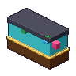 |  |
| 16 | `boba_bar` | kitchen_food | Tea-Pearl Boba Bar | Stainless steel commercial counter with clear sneeze guard canopy; Chilled insert wells filled with tapioca pearls, fruit jellies, and syrups; Countertop cup-sealing machine with digital readout; Straw holder dispenser and shaker tins | Completed | 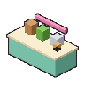 |  |
| 17 | `mini_arcade` | entertainment | Retro Pixel Arcade | Classic upright coin-op arcade cabinet with angled side art; Illuminated top marquee sign with custom retro pixel title; Tilted CRT monitor display with vivid gameplay graphics and screen glare; Slanted control panel deck with joystick and 6 action buttons, plus coin door with coin return slots | Completed |  |  |
| 18 | `noodle_cart` | kitchen_food | Midnight Noodle Cart | Traditional artisan timber street cart with cloth noren entrance banner; Boiling noodle broth cauldron with steam puffs; Tiered ingredient containers with bamboo noodle strainers; Spoked timber wheels and cart handles | Completed | 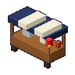 |  |
| 19 | `karaoke_machine` | entertainment | Star Stage Karaoke | High-powered sound tower with dual glowing speaker woofer cones and mesh grilles; Central widescreen color monitor with animated lyric prompt bars; Dual wireless microphones resting in side docking cradles; Pulsing multicolor LED base wash light | Completed |  |  |
| 20 | `telescope` | outdoor_pool | Stargazer Telescope | Classic polished brass refractor telescope tube with focus knob and dew shield; Sturdy wooden surveyor tripod with brass spreader chains; Alt-azimuth swivel mount with locking dials; Glass objective lens with specular glint | Completed |  | 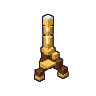 |
| 21 | `sky_viewer_nyc` | entertainment | Skyline Viewer: New York Skyline | Heavy-duty tourist viewing binocular turret on 360-degree swivel yoke; Cast-iron stepped circular base platform with non-slip footpad; Twin rubber-hooded optical eyepieces and focusing wheel; Polished brass and steel finish with coin acceptor slot for viewing timer | Completed |  |  |
| 22 | `sky_viewer_singapore` | entertainment | Skyline Viewer: Singapore Marina | Marina-themed binocular viewing turret with nautical brass finish; Stepped platform base and coin-operated timer box; Dual optical viewing eyepieces aimed toward the waterfront; Sturdy swivel fork mounting | Completed |  |  |
| 23 | `sky_viewer_tokyo` | entertainment | Skyline Viewer: Tokyo Lights | Sleek cybernetic-styled coin-op binocular tower with illuminated accents; Twin high-magnification eyepieces with weather-sealed rubber gaskets; Heavy weighted round base pedestal with diamond-plate footing; Swiveling observation telescope body | Completed |  | 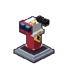 |
| 24 | `sky_viewer_paris` | entertainment | Skyline Viewer: Paris Rooftops | Vintage Parisian cast-iron binocular viewer with antique verdigris patina; Stepped round mounting dais with decorative fluting; Twin brass eyepieces and viewing coin slot; Heavy balanced yoke assembly | Completed | 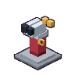 |  |
| 25 | `koi_pond` | outdoor_pool | Zen Koi Stone Pond | Natural irregular flagstone rim with mortar joints and coping overhang; Deep layered aquatic gradient from turquoise shallows to deep teal abyss; Floating circular lily pads with signature leaf notches and pink water lily blossoms; Swimming orange, white, and black Nishikigoi koi fish silhouettes beneath surface | Completed |  | 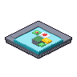 |
| 26 | `capsule_dispenser` | entertainment | Gachapon Capsule Toy | Transparent spherical gachapon globe packed with multi-colored toy capsules; Cast-metal crimson housing body with chrome coin slide and turn crank handle; Clear drop chute door showing an awarded capsule ready to collect; Heavy pedestal stand with stable base | Completed |  |  |
| 27 | `gumball_trophy` | entertainment | Gumball Collector Trophy | Polished dark walnut stepped pedestal plinth with engraved brass nameplate; Hand-blown clear glass bell jar cloche with crystal top handle; Legendary floating Golden Gumball displayed on velvet cushion inside with star glints; Showcase museum presentation | Completed |  |  |
| 28 | `suite_bed` | beds | Cloud-Soft Suite Bed | King platform bed with upholstered tall headboard with vertical seam channels; Crisp white hotel duvet folded neatly with contrasting velvet bed runner; Four plump sleeping pillows propped against headboard with center indentations; Flanking integrated walnut nightstands with bedside lamps | Completed |  | 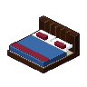 |
| 29 | `treadmill` | entertainment | AeroRun Treadmill | Inclined running deck with heavy-duty black textured rubber running belt; White central lane alignment guide stripes on belt; Integrated side foot rails with non-skid treads; Ergonomic upright support arms with heart-rate pulse sensor handgrips; Wide illuminated digital console with simulated speed/incline display and red safety clip | Completed | 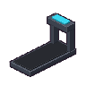 | 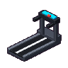 |
| 30 | `weight_bench` | seating | Titan Weight Bench | Heavy boxed steel frame with rubber end caps; Dense vinyl-upholstered pad with stitched seam borders; Incline adjustment support strut with selector pin; High-grip non-slip textured finish | Completed | 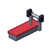 | 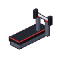 |
| 31 | `dumbbell_rack` | entertainment | Hex Dumbbell Rack | Heavy two-tier commercial steel rack with angled saddle cradles; Array of paired cast-iron rubber-encased hex dumbbells graduating from small to large; Knurled chrome handles visible on each dumbbell; Non-marking rubber foot pads on rack legs | Completed | 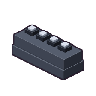 | 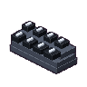 |
| 32 | `yoga_mat` | rugs | Zen Yoga Mat | Textured closed-cell foam mat with rounded corners; Embossed non-slip alignment grip lines; Partially rolled end showing thickness; Carrying strap buckle detail | Completed |  | 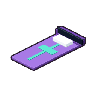 |
| 33 | `dining_table` | tables | Bistro Dining Table | Solid hardwood top with perimeter bevel and plank seams; Four turned timber legs with mortise corner brackets; Woven fabric table runner down center; Subtle wood grain flecks and highlights | Completed | 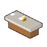 | 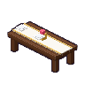 |
| 34 | `dining_chair` | seating | Velvet Dining Chair | Curved upholstered velvet backrest with piped border; Plump cushioned seat with welt cord; Slender tapered legs with polished brass ferrules; Solid wood stretcher underframe | Completed | 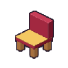 |  |
| 35 | `buffet_counter` | kitchen_food | Grand Buffet Counter | Multi-bay heated stainless steel food warming counter; Polished chafing dishes with domed roll-top covers; Angled glass sneeze-guard canopy with overhead warming heat lamps; Lower plate warmer cabinet with stainless doors | Completed | 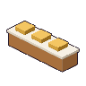 | 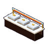 |
| 36 | `chef_station` | kitchen_food | Teppanyaki Chef Station | Heavy Japanese steel teppanyaki flat-top plancha griddle; Surrounding timber dining ledge with place settings; Stainless commercial overhead exhaust ventilation hood; Chef squeeze bottles, spatulas, and seasoning shakers | Completed | 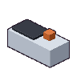 | 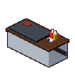 |
| 37 | `pool_water` | outdoor_pool | Heated Lap Pool | Inviting cyan swimming pool water surface with animated caustic ripple reflections; Deep blue mosaic tile lining visible underwater with depth gradient; Smooth white cast-stone pool coping edge with water-drop highlights; Submerged pool step ledge | Completed |  |  |
| 38 | `sauna_cabin` | outdoor_pool | Cedar Sauna Entrance | Horizontal tongue-and-groove Nordic cedar plank siding with grain texture; Full-height bronze tempered glass door with wooden safety handle; Volcanic sauna stone rock basket stove with glowing heating elements and steam; Upper and lower cedar slatted interior benches visible through glass | Completed | 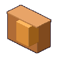 | 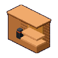 |
| 39 | `towel_rack` | outdoor_pool | Spa Towel Caddy | Three-tier teak spa caddy with slatted shelves; Neat bundles of fluffy rolled white spa towels stacked on upper shelves; Woven natural wicker laundry basket for used towels on lower shelf; Moisture-resistant oil finish on teak | Completed |  |  |
| 40 | `espresso_bar` | kitchen_food | Artisan Espresso Bar | Commercial dual-group polished chrome espresso machine with portafilters; Twin steam wands with milk pitchers and top cup warmer with demitasses; Bean hopper grinder alongside knock box for espresso pucks; Syrup bottles and barista tamp mat | Completed | 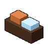 | 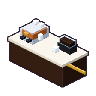 |
| 41 | `cafe_table` | tables | Marble Cafe Table | Heavy ornate 3-legged cast-iron pedestal base; Polished circular white Carrara marble top with grey mineral veining; Protective brass edge bullnose banding; Central support column with fluting | Completed |  | 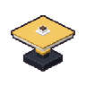 |
| 42 | `pool_table` | entertainment | Championship Billiards | Solid hardwood cabinet with fluted corner legs and cast brass corner pocket irons; Tournament-grade worsted wool green felt playing surface with head string marker; Drop pockets with leather nets holding balls; Racked triangle ball cluster and white cue ball on baize, with cue sticks in side clips | Completed | 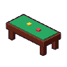 | 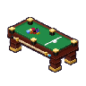 |
| 43 | `computer_desk` | tables | Workstation Desk & PC | Executive workstation desk with drawer pedestal and brushed handles; Dual-screen computer setup with active illuminated desktop screens; Mechanical keyboard, mouse on mat, and desk grommet cable pass; Cable management cutout | Completed | 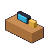 |  |
| 44 | `sky_tree` | plants | Ornamental Sakura Tree | Gnarled branching sakura trunk with bark texture; Volumetric cherry blossom cloud clumps with organic jaggies; Falling petal flecks in breeze; Stone tree surround base with soil | Completed |  | 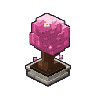 |
| 45 | `garden_bench` | seating | Teak Garden Bench | Ornate cast-iron arched legs and scrolled armrests with bolt heads; Contoured seat and backrest made of separate teak slats with visible gaps; Wood grain texture on each individual plank slat; Reinforcing iron center support bracket | Completed | 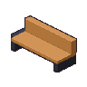 | 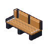 |
| 46 | `flower_planter` | plants | Botanical Hedgerow | Ashlar stone planter box with block texture and coping lip; Rich dark soil bed; Dense billowing hedge mass rising above rim with 4-shade leafy clumps; Hydrangea blue and marigold orange flower petal clusters; Trailing leaves spilling over the edge | Completed | 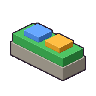 | 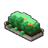 |
| 47 | `marble_pillar` | decor | Grand Corinthian Pillar | Carved Corinthian column capital with acanthus leaves; Fluted vertical column shaft with 2x shadow grooves; Stepped circular torus base with polished gold band; Subtle creamy marble veining throughout | Completed |  |  |
| 48 | `chandelier` | lighting | Imperial Crystal Chandelier | Tiered multi-ring polished brass frame; Cascading multifaceted cut-crystal teardrop pendants with sparkles; Candelabra candle sleeves with warm flame bulbs; Center brass finial and hanging chain | Completed |  |  |
| 49 | `grand_staircase` | decor | Grand Mezzanine Staircase | Wide flared marble stair treads with shadowed riser steps; Carved mahogany handrail supported by turned baluster spindles; Opulent royal red carpet runner centered down the flight with brass stair rods; Grand starting newel post with finial | Completed | 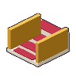 |  |
| 50 | `lobby_fountain` | decor | Atrium Marble Fountain | Carved stone tiered basin with projecting coping lips; Central stone fountain spire with tiered overflow bowls; Water ripples with concentric wave highlights and sparkle glints; Submerged wishing coins scattered on floor of basin | Completed |  |  |
| 51 | `luggage_trolley` | decor | Brass Bellhop Trolley | Tubular polished brass birdcage frame with coat hanging hooks; Red plush carpeted luggage platform deck with rubber bumper guard; Four heavy-duty swivel caster wheels; Stacked leather vintage suitcases with brass corner locks and straps | Completed |  |  |
| 52 | `concierge_desk` | tables | Concierge Podium | High-standing solid mahogany podium with raised moulding panels; Slanted reading top with leather blotter and open guest register book; Polished brass swan-neck reading lamp; Brass corner protectors and foot rail | Completed |  |  |
| 53 | `lobby_runner` | rugs | Royal Velvet Runner | Deep crimson velvet runner carpet with rich nap; Intricate gold bullion braided border; Gold fringe tassels on ends; Subtle repeating damask pattern | Completed |  |  |
| 54 | `gym_mirror` | fitness | Gym Mirror Wall | Bevelled mirror glass panels with silver seams; Diagonal reflection sheen streaks; Brushed aluminum base retaining rail; Clear depth separation from back wall | Completed |  |  |
| 55 | `exercise_bike` | fitness | Pulse Exercise Bike | Angular 2:1 steel chassis frame; Cylindrical flywheel housing with metallic sheen reflection; Pedal crank arms with foot pedals; Ergonomic racing saddle on adjustable seatpost; Curved handlebars with glowing digital workout console | Completed |  |  |
| 56 | `rowing_machine` | fitness | HydroRower Machine | Long extruded dual-rail slide beam; Contoured ergonomic sliding seat on runner wheels; Front air/water resistance flywheel fan housing; Handle bar and chain linkage; Angled footplates with heel cups and strap details | Completed |  |  |
| 57 | `squat_rack` | fitness | Titan Squat Rack | Dual heavy-gauge steel uprights with laser-cut peg holes; Adjustable red J-hooks and safety spotter arms; Knurled barbell resting on hooks with cast-iron Olympic plates; Overhead knurled pull-up crossbar | Completed |  |  |
| 58 | `gym_lockers` | fitness | Metal Gym Lockers | 3-tier steel locker bank with vertical door seams; Ventilation louvers stamped at top and bottom of each locker; Chrome latch hasps with padlock eyelets; Recessed plinth base and side trim | Completed |  |  |
| 59 | `water_cooler` | fitness | Spring Water Cooler | Inverted translucent blue polycarbonate 5-gallon jug with water level line; Air bubble highlight in bottle; White dispenser body with drip tray; Dual red (hot) and blue (cold) push taps and side paper cup stack | Completed |  |  |
| 60 | `round_dining_table` | tables | Grand Dining Table | Large circular banquet table with radiating wood veneer quarters; Substantial central turned timber pedestal with scrolled base feet; Cascading white linen tablecloth with draped hem folds; Polished surface sheen | Completed |  |  |
| 61 | `dining_booth` | seating | Velvet Dining Booth | High-back dining booth with vertical channel tufting; Deep velvet bench cushion with piped edge; Sturdy wooden end panels with laminate kickplate; Plush comfortable silhouette | Completed |  |  |
| 62 | `wine_wall` | decor | Grand Wine Wall | Floor-to-ceiling dark oak temperature-controlled wine display; Diamond lattice and horizontal bottle rack shelving; Individual green and amber glass wine bottles with neck foils and labels; Subtle interior LED strip downlighting on bottles | Completed |  |  |
| 63 | `maitre_d_podium` | decor | Maître D' Podium | Slender dark walnut podium with brass accent inlay; Tilted reading lectern holding the daily hotel dining ledger book with bookmark ribbon; Brass goose-neck adjustable desk lamp; Locking lower storage cabinet | Completed |  |  |
| 64 | `grand_piano` | entertainment | Concert Grand Piano | Glossy mirror-ebony lacquer curved piano rim and soundboard; Open piano lid propped high on wooden lid prop stick; Cast-iron harp plate with gold finish and silver piano strings; 88-key ivories keybed with fallboard, music desk, and 3 brass pedals on pedal lyre | Completed |  |  |
| 65 | `wall_sconce` | lighting | Brass Wall Sconce | Polished brass wall escutcheon plate with mounting screws; Graceful curved swan-neck support arm; Frosted fluted glass tulip shade; Warm incandescent bulb illumination | Completed |  |  |
| 66 | `kitchen_range` | kitchen_food | Commercial Stove Range | Heavy-duty commercial 6-burner gas range with heavy cast-iron trivets; Vibrant red burner control knobs along front manifold; Full-width front towel/plate rail; Twin commercial standard baking ovens below with pull-down handles | Completed |  |  |
| 67 | `kitchen_prep_table` | kitchen_food | Stainless Prep Counter | Commercial NSF 304 food-grade stainless steel top with rolled bullnose front edge; Heavy tubular stainless legs with adjustable levelling bullet feet; Galvanised lower undershelf holding stainless hotel pans; Smooth polished metallic reflection | Completed |  |  |
| 68 | `kitchen_sink` | kitchen_food | Commercial Double Sink | Deep double-bowl commercial stainless steel sink compartments; High-arc commercial pre-rinse spring gooseneck faucet with spray valve; Sloped corrugated drainboards on left and right for drying racks; Basket strainer drains and splashback wall guard | Completed |  |  |
| 69 | `kitchen_fridge` | kitchen_food | Walk-in Kitchen Fridge | Massive double-door commercial reach-in stainless steel refrigerator; Top-mounted refrigeration compressor housing with ventilation grille; Heavy-duty chrome cam-lift latch handles with keylocks; Exterior digital temperature readout display | Completed |  |  |
| 70 | `kitchen_pass` | kitchen_food | Kitchen Service Pass | Heated stainless steel plating pass-through counter; Overhead dual infrared heat lamp strip casting warm culinary glow; Order ticket spinning wheel / ticket rail with guest check slips; Chrome service bell for server pick-up | Completed |  |  |
| 71 | `starting_block` | outdoor_pool | Olympic Starting Block | Official Olympic pool starting block with forward-angled platform; High-traction textured non-slip tread surface on platform with lane number decal; Stainless steel backstroke starting grab bar mounted to front; Sturdy powder-coated pedestal base bolted to pool deck | Completed |  |  |
| 72 | `lane_rope` | outdoor_pool | Pool Lane Divider Rope | Floating racing lane divider cable with alternating high-density red and white anti-turbulent discs; Heavy-duty stainless steel tensioning ratchet reel at deck anchor; Water line ripples where floats meet the pool surface; Crisp repeating buoyant disc pattern | Completed |  |  |
| 73 | `pool_ladder` | outdoor_pool | Chrome Pool Ladder | Polished 316 marine-grade stainless steel tubular handrails with smooth bends; Three wide non-skid stainless step treads with rubber grip pads; Twin round deck escutcheon anchor flanges securing rails to coping; Submerged lower bumpers resting against pool wall | Completed |  |  |
| 74 | `pool_lounger` | seating | Cushioned Pool Lounger | Water-resistant slatted chaise frame with wood grain; Multi-position ratchet recline backrest; Thick full-length padded lounger mattress with tie-downs; Rear wheel casters for moving on pool deck | Completed |  |  |
| 75 | `pool_umbrella` | outdoor_pool | Resort Sun Umbrella | Large 8-panel octagonal resort canvas parasol canopy with wind vent cap; Solid eucalyptus center mast and rib hub mechanism; Heavy weighted circular granite slab base with locking collar; Scalloped canopy valance hem with drop shade | Completed |  |  |
| 76 | `changing_cubicle` | outdoor_pool | Changing Room Cubicle | Commercial privacy changing stall with white melamine panel walls; Satin anodized aluminum upright corner posts and ceiling bracing; Swinging privacy modesty door with red/green occupied indicator latch; Interior clothing hook and small bench corner | Completed |  |  |
| 77 | `changing_room_door` | outdoor_pool | Changing Room Louvered Door | White painted solid wooden door with horizontal louvered ventilation slats; Satin chrome commercial lever handle with privacy lock cylinder; Stainless steel protective kickplate on bottom; Deep door frame moulding and shadowed threshold | Completed |  |  |
| 78 | `salon_chair` | seating | Salon Styling Chair | Heavy circular chrome hydraulic base with foot pump pedal; Contoured black faux-leather bucket seat with ribbed stitching; Polished chrome armrests; Padded chrome footrest bar with rubber grip | Completed |  |  |
| 79 | `massage_bed` | seating | Spa Massage Bed | Solid natural beechwood frame with lower storage slatted shelf; Thick multi-layer mattress with ultra-soft white vinyl covering; Contoured ergonomic face cradle cushion; Rolled white spa towel accent on end | Completed |  |  |
| 80 | `spa_partition` | decor | Spa Glass Partition Wall | Frameless frosted acoustic glass partition wall; Laser-etched zen bamboo reed silhouettes on glass; Satin stainless steel top and bottom recessed mounting channels; Subtle translucent light transmission | Completed |  |  |
| 81 | `spa_door` | decor | Spa Glass Door Archway | Tempered glass double door set with satin steel perimeter frame; Full-height vertical architectural ladder pull handles; Overhead glass transom panel with pivot hardware; Clear frosted privacy bands | Completed |  |  |
| 82 | `pergola` | plants | Garden Pergola with Vines | Sturdy timber posts with metal footing brackets; Overhead slatted crossbeams and rafters with wood grain; Climbing wisteria/ivy vines with leafy clusters; Draping floral clusters hanging between slats | Completed |  |  |
| 83 | `arcade_reserved` | decor | Reserved Arcade Zone | Pair of polished mirror-chrome stanchion posts with weighted dome bases; Heavy twisted crimson velvet barrier rope with snap-hook ends; Natural catenary drape curve of the barrier rope; VIP floor indicator | Completed |  |  |
| 84 | `arcade_snake_1` | entertainment | Noodle Snake (Classic) | Retro green woodgrain arcade cabinet with "Noodle Snake" classic marquee art; CRT monitor displaying moving green pixel snake eating glowing fruit on dark grid; Angled control panel with ball-top joystick and large retro push buttons; Coin insert door with dual 25-cent illuminated reject buttons | Completed |  |  |
| 85 | `arcade_snake_2` | entertainment | Noodle Snake (Neon) | Cyberpunk neon-cyan cabinet with custom holographic "Neon Snake" marquee banner; High-contrast glowing neon CRT screen with trailing snake light trails; Illuminated LED joystick and glow buttons; Speaker grille and side vector art decals | Completed |  |  |
| 86 | `arcade_breakout_1` | entertainment | Brick Bash (Retro) | Vintage 1970s orange-toned cabinet with "Brick Bash" retro lettering; Tilted screen showing multi-colored brick wall and reflecting paddle ball with angle lines; Precision spinner paddle dial knob and ball-launch button on deck; Authentic speaker slots and coin door | Completed |  |  |
| 87 | `arcade_breakout_2` | entertainment | Brick Bash (Turbo) | High-octane purple/magenta "Turbo Brick" cabinet with explosive side artwork; CRT display showing multi-ball powerups, lasers, and crumbling bricks; Dual launch buttons and heavy-duty spinner controller; Black light illuminated coin return | Completed |  |  |
| 88 | `arcade_drop_1` | entertainment | Block Drop (Puzzle) | Deep blue cabinet with "Block Drop" puzzle tetromino marquee; Vibrant screen displaying falling polyomino shapes and clearing matrix line flashes; 4-way arcade joystick with hard-drop and rotation buttons; Sturdy plywood cabinet with T-molding edge trim | Completed |  |  |
| 89 | `arcade_drop_2` | entertainment | Block Drop (Deluxe) | Deluxe golden edition "Block Drop" cabinet with gleaming gold T-molding trim; Screen displaying high-tier puzzle action with glowing combo multipliers; Premium arcade joystick and backlit pushbuttons; Front stereo sound speakers with chrome rings | Completed |  |  |
| 90 | `arcade_leaderboard` | entertainment | Arcade Hall of Fame | Massive floor-standing illuminated Hall of Fame scoreboard marquee; Multi-line high score matrix with glowing amber/cyan LED text showing player ranks and scores; Crown ornament with gold, silver, and bronze trophy emblems; Flanking neon pillar lights and polished chrome frame | Completed |  |  |
| 91 | `wardrobe` | decor | Oak Wardrobe | Double-door solid oak wardrobe with recessed panel mouldings; Deep carved top cornice and sturdy plinth base with bun feet; Ornate brass keyhole escutcheons and teardrop pull handles; Wood grain texture on door panels with plank seams | Completed |  |  |
